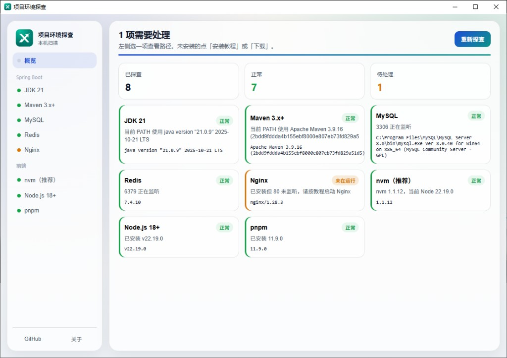
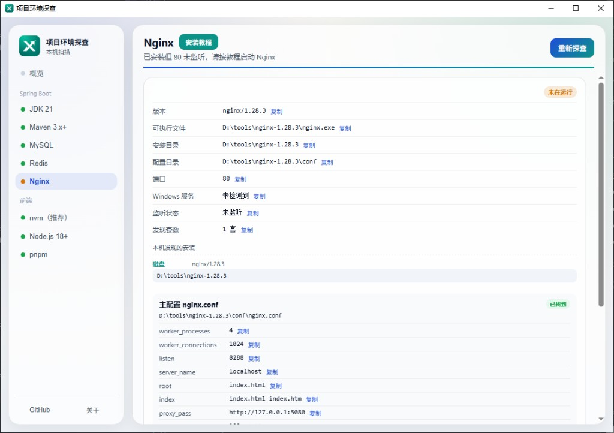
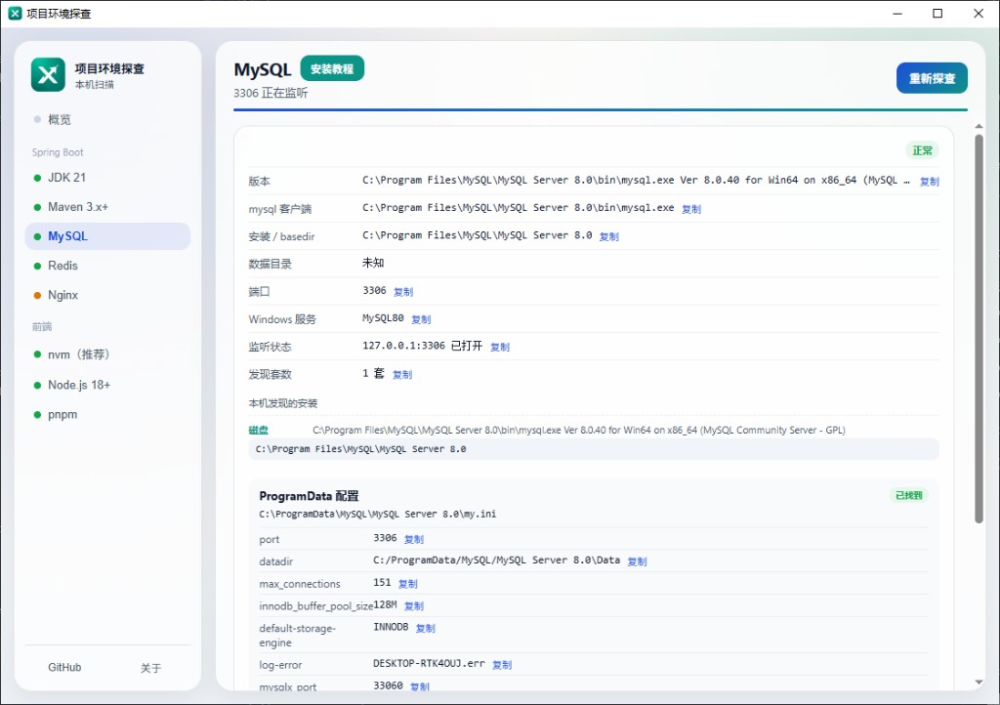

# 项目环境探查

Windows 上用的小工具：在**本机**查看 Spring Boot 常用开发环境是否装好、路径在哪、服务有没有起来。扫描结果只显示在本机窗口里，**不会上传**。

## 会检查什么

| 分类 | 项目 |
| --- | --- |
| Spring Boot | JDK 21、Maven 3、MySQL、Redis、Nginx |
| 前端（推荐 nvm） | nvm、Node.js 18+、pnpm |

未安装时，标题旁可以打开**安装教程**和**官方下载页**。

## 界面预览

概览 — 一次看清本机各项是否就绪：



工具详情 — 路径、版本、配置都可以复制；标题旁打开安装教程：





## 安装

仅支持 **Windows**。从 [GitHub Release](https://github.com/JackXhl/dev-env-tool/releases) 下载安装包，按向导安装后打开「项目环境探查」。安装后的可执行文件是 `env-probe.exe`。

## 从源码构建

需要：Rust（含 Windows 目标）、Node.js、WebView2。

```bat
git clone https://github.com/JackXhl/dev-env-tool.git
cd dev-env-tool
npm install
npm run tauri -- dev
```

打包安装包：`npm run tauri -- build`。国内 Cargo 加速写到用户目录 `%USERPROFILE%\.cargo\config.toml`，不要提交仓库里的 `.cargo/`。

**不要**对 `nginx.exe` 执行 `-v`，也**不要**直接运行 `nvm.exe` 探测版本。

## 本机覆盖下载地址

仓库里的 `src-tauri/resources/links.json` 指向官网。若你本机想改用网盘，复制：

```bat
copy src-tauri\resources\links.local.json.example src-tauri\resources\links.local.json
```

按 key 覆盖 `download` / `tutorial`。`links.local.json` 不要提交。

品牌与关于页文案只改 `src-tauri/resources/brand.json`。

## 反馈

问题与建议请到 [GitHub Issues](https://github.com/JackXhl/dev-env-tool/issues)。

## 支持一下

项目环境探查完全免费、开源。如果这个工具帮你省下了时间或配环境的麻烦，欢迎随缘打赏一杯咖啡 ☕

> 打赏纯属自愿，不影响任何功能使用。感谢每一位支持者的鼓励！

| 微信扫一扫 | 支付宝扫一扫 |
| :---: | :---: |
|  |  |

## 许可证

MIT。详见 [LICENSE](LICENSE)。
